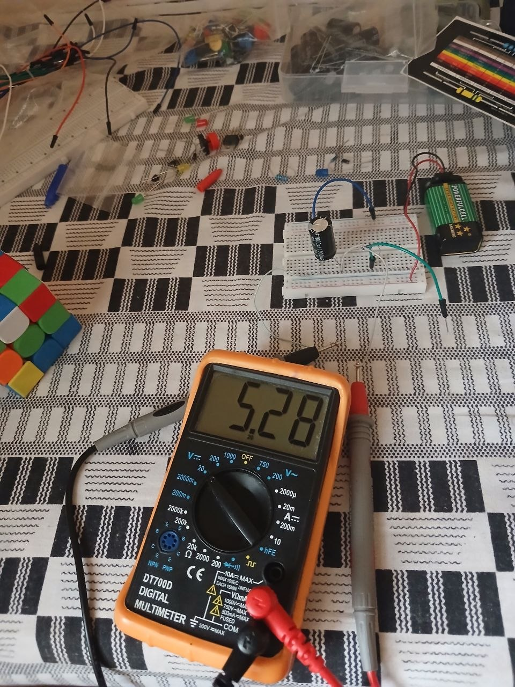
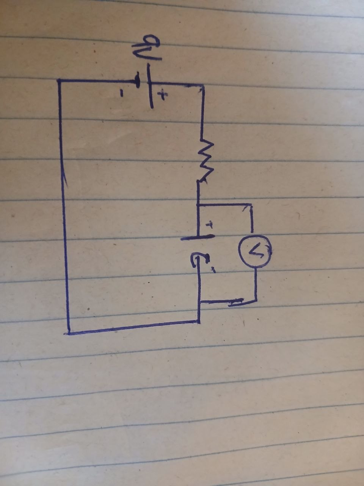
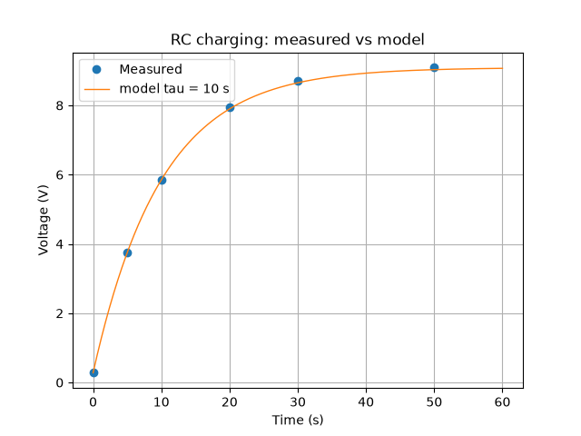

# RC Charging: Measured vs Model

## Goal
Measure how a capacitor charges through a resistor, then compare the readings with the model V(t) = Vf - (Vf - V0) e^(-t/tau).

## Circuit
- 9 V battery
- 10 kohm resistor in series with a 1000 uF electrolytic capacitor
- Multimeter in DC volts across the capacitor
- The capacitor was discharged through a 100 ohm resistor before the run

Expected time constant: tau = RC = 10,000 x 0.001 = 10 s.

## Method
1. Connected the last wire and started the video at the same moment.
2. Read the multimeter from the video at 0, 5, 10, 20, 30, and 50 s.
3. Plotted the readings against the model in Python (numpy and matplotlib).

## Readings

| Time (s) | Voltage (V) |
|----------|-------------|
| 0        | 0.28        |
| 5        | 3.76        |
| 10       | 5.85        |
| 20       | 7.94        |
| 30       | 8.71        |
| 50       | 9.09        |

## Result

Measured tau is about 10 s, so the capacitor is close to its rated 1000 uF. The readings sit within about 0.1 V of the model.

## Notes
- The 0.28 V at 0 s is leftover charge on the capacitor.
- At 5 s, an earlier note gave 4.00 V. I used 3.76 V from the video, which fits the model.
- Electrolytic capacitors have a wide tolerance, so a small difference from the rated value is normal.

## Files
- RC_tau.py: reads the data, computes the model, and saves the plot

## Next steps
- Build the same model with the control library and compare the two curves
- Run 2 with 47 kohm and 470 uF (expected tau about 22 s)
