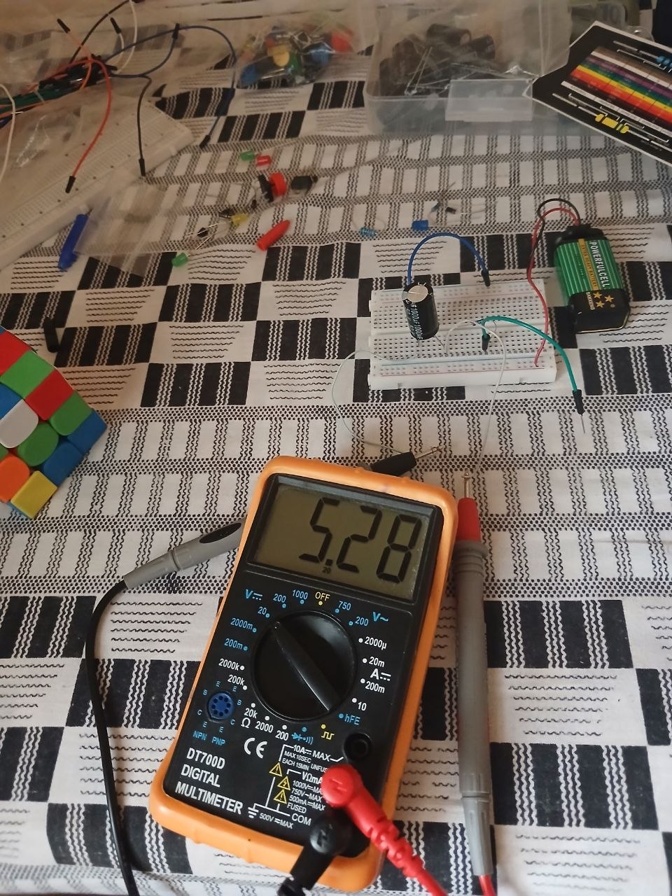
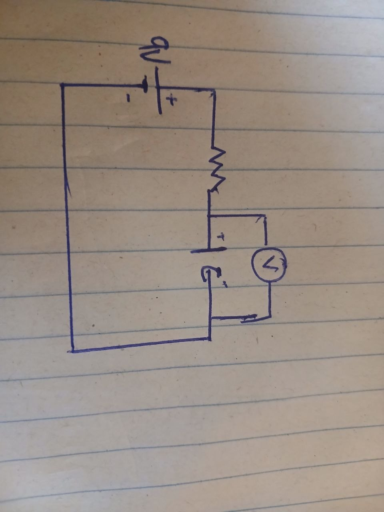
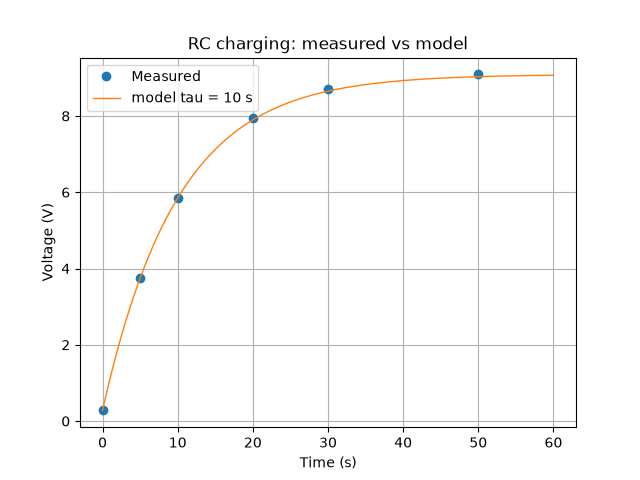
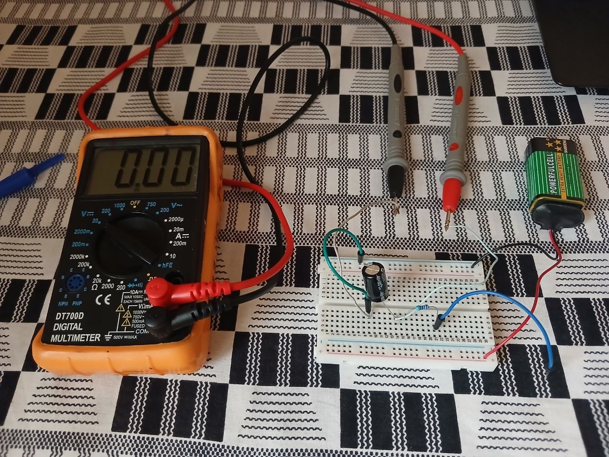
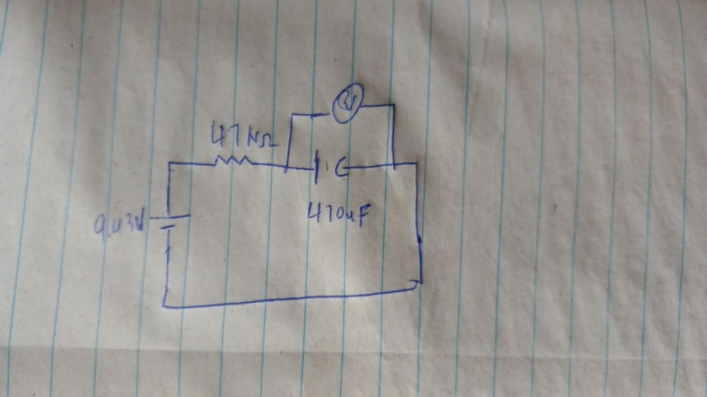
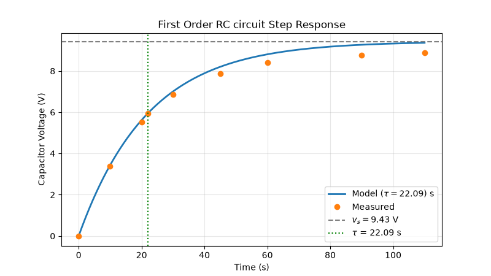

# RC Charging: Measured vs Model

## Goal
Measure how a capacitor charges through a resistor, then compare the readings with a first order model: V(t) = Vf - (Vf - V0) e^(-t/tau). Two runs were done with different resistor and capacitor values. In run 2 the model is built with the Python control library.

## Summary

| Run | Resistor | Capacitor | Expected tau | Measured tau |
|-----|----------|-----------|--------------|--------------|
| 1   | 10 kohm  | 1000 uF   | 10 s         | about 10 s   |
| 2   | 47 kohm  | 470 uF    | 22.1 s       | about 20.5 s |

In both runs the capacitor charged close to the model. In run 2 the capacitor levelled off near 8.9 V, below the 9.43 V supply. The likely cause is leakage in the electrolytic capacitor.

---

## Run 1: 10 kohm and 1000 uF

### Circuit
- 9 V battery
- 10 kohm resistor in series with a 1000 uF electrolytic capacitor
- Multimeter in DC volts across the capacitor
- The capacitor was discharged through a 100 ohm resistor before the run

Expected time constant: tau = RC = 10,000 x 0.001 = 10 s.

### Method
1. Connected the last wire and started the video at the same moment.
2. Read the multimeter from the video at 0, 5, 10, 20, 30, and 50 s.
3. Plotted the readings against the model in Python (numpy and matplotlib).

### Readings

| Time (s) | Voltage (V) |
|----------|-------------|
| 0        | 0.28        |
| 5        | 3.76        |
| 10       | 5.85        |
| 20       | 7.94        |
| 30       | 8.71        |
| 50       | 9.09        |

### Result

Measured tau is about 10 s, so the capacitor is close to its rated 1000 uF. The readings sit within about 0.1 V of the model.

### Notes
- The 0.28 V at 0 s is leftover charge on the capacitor.
- At 5 s, an earlier note gave 4.00 V. I used 3.76 V from the video, which fits the model.
- Electrolytic capacitors have a wide tolerance, so a small difference from the rated value is normal.

---

## Run 2: 47 kohm and 470 uF

### Circuit
- Same circuit as run 1 with a new resistor and capacitor
- 9 V battery, measured at 9.43 V with the multimeter
- 47 kohm resistor in series with a 470 uF electrolytic capacitor
- Multimeter in DC volts across the capacitor
- The capacitor was discharged through a 100 ohm resistor until the meter read 0.00 V

Expected time constant: tau = RC = 47,000 x 0.00047 = 22.1 s. The capacitor should be close to fully charged after 5 tau, about 110 s.

### Method
1. Discharged the capacitor with the 100 ohm resistor and checked that the meter read 0.00 V.
2. Connected the last wire and started the stopwatch and the video at the same moment. The multimeter and the stopwatch were in the same frame.
3. Read the multimeter from two videos at 0, 10, 20, 22, 30, 45, 60, 90, and 110 s, then averaged the two readings at each time.
4. Built the model with the control library. A series RC circuit is a first order system with the transfer function 1 / (tau s + 1). I took its step response with `ct.step_response` and multiplied it by the supply voltage.
5. Plotted the averaged readings against the model in Python (numpy, matplotlib, and control).

### Readings

| Time (s) | Video A (V) | Video B (V) | Average (V) | Model (V) |
|----------|-------------|-------------|-------------|-----------|
| 0        | 0.00        | 0.00        | 0.00        | 0.00      |
| 10       | 3.49        | 3.28        | 3.385       | 3.43      |
| 20       | 5.63        | 5.44        | 5.535       | 5.62      |
| 22       | 6.03        | 5.87        | 5.95        | 5.95      |
| 30       | 6.92        | 6.80        | 6.86        | 7.01      |
| 45       | 7.88        | 7.88        | 7.88        | 8.20      |
| 60       | 8.40        | 8.41        | 8.405       | 8.81      |
| 90       | 8.75        | 8.80        | 8.775       | 9.27      |
| 110      | none        | 8.88        | 8.88        | 9.37      |

The model uses R = 47 kohm, C = 470 uF, and a supply of 9.43 V.

### Result

The readings follow the model closely up to 30 s. At 22 s, which is one tau, the average is 5.95 V and the model gives 5.95 V. After 30 s the readings fall below the model. By 90 s the gap is about 0.5 V, and the capacitor levels off near 8.9 V instead of the 9.43 V supply.

The capacitor reaches 63.2% of the level it settles at (about 5.6 V) at about 20.5 s. That is about 7% below the expected 22.1 s, which is inside the tolerance of an electrolytic capacitor.

Likely cause of the lower final voltage: leakage current through the electrolytic capacitor. Leakage acts like a large resistor across the capacitor. It lowers the final voltage and shortens tau. A curve fit will test this (see Next steps).

### Notes
- The capacitor started at 0.00 V. In run 1 it started at 0.28 V, so discharging with the 100 ohm resistor until the meter read zero worked.
- The two videos differ by about 0.2 V at 10 s and 20 s. The curve is steepest there, and a timing difference of less than 1 s changes the reading by 0.2 V. The two videos agree within 0.05 V from 45 s onward.
- The 110 s reading comes from one video, because the other video ended before 110 s.
- An AI tool read the same videos as a cross check. Its averages agreed with mine within 0.12 V.
- Electrolytic capacitors have a wide tolerance, often 20%, so a difference between the rated and measured tau is normal.

---

## Files
- RC_tau.py: run 1, reads the data, computes the model, and saves the plot
- RC_tau2.py: run 2, reads the averaged data, builds the model with the control library, and saves the plot

## Next steps
- Fit the run 2 readings with scipy `curve_fit`, with the final voltage and tau as the two free values
- Use the fitted final voltage to calculate the leakage resistance, and check that it explains the shorter tau
- Fit the run 1 readings the same way and compare the two runs
